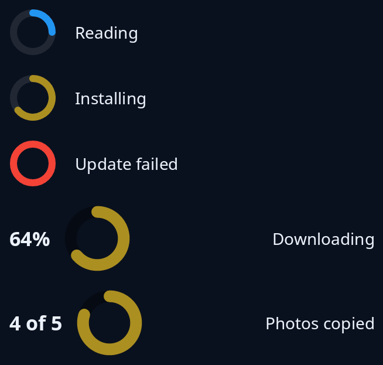

# Ring

`ring(share, size)` is a ring that fills clockwise from the top as `share` goes from 0 to 1, for a job whose end can be guessed. `.tone(..)` colours it: `Tone::Accent` for something the person asked for that is going ahead, `Tone::Problem` for a failure. A tone stays when the ring is full.

`tiles::standard_ring(share, across)` is the thicker ring with round ends for downloads, installs and an amount of a limit, with the percentage on its left. `standard_ring_with(share, figure, across)` puts your own figure there, such as "4 of 5", or none. With `None` as the share, the standard ring turns while the end cannot be guessed (a picture shows one frame of that).



**The screen reader hears:** a progress indicator called "Progress", from 0 to 1. The standard ring with no share is heard as busy.

Say what is happening in words beside it. See [progress](../guides/progress.md).

<!-- picture width 360 -->
```rust
use trindle_toolkit::tiles::{standard_ring, standard_ring_with};
use trindle_toolkit::widget::{column, label, ring, row, Node, Tone};

fn view() -> Node<()> {
    column(vec![
        row(vec![ring(0.25, 40.0), label("Reading")]).gap(16.0),
        row(vec![ring(0.64, 40.0).tone(Tone::Accent), label("Installing")]).gap(16.0),
        row(vec![ring(1.0, 40.0).tone(Tone::Problem), label("Update failed")]).gap(16.0),
        row(vec![standard_ring(Some(0.64), 56.0), label("Downloading")]).gap(16.0),
        row(vec![standard_ring_with(Some(0.8), Some("4 of 5".to_string()), 56.0), label("Photos copied")]).gap(16.0),
    ]).gap(16.0).padding(24.0)
}
# let _ = view();
```
