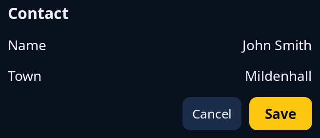

# Row and column

`column` puts items one above another and `row` puts them side by side, each centred on the row's middle. They are the two containers most layouts are built from. Set the room between items with `.gap(..)` and the room inside the edge with `.padding(..)`; without a gap they use the style sheet's.



For the other containers and the sizes an item can take, see [layout](../guides/layout.md).

<!-- picture width 360 -->
```rust
use trindle_toolkit::widget::{column, heading, label, main_word, row, space, word_button, Node};

fn view() -> Node<()> {
    column(vec![
        heading("Contact"),
        row(vec![label("Name"), space(), label("John Smith")]),
        row(vec![label("Town"), space(), label("Mildenhall")]),
        row(vec![space(), word_button("Cancel").on_press(()), main_word("Save").on_press(())]).gap(8.0),
    ]).gap(12.0).padding(24.0)
}
# let _ = view();
```
