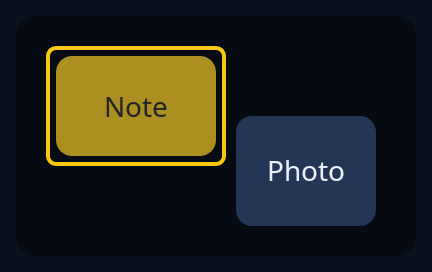

# Scene

`Scene` is a canvas of items you place, which the person can choose, move, zoom and pan. It is not a node: you keep it and its `View` in your own state, paint it in a `drawing`, and pass the drawing's pointer and keys on to `Scene::pointer` and `Scene::key`, which say what changed (`Change::Chosen`, `Moved` or `Looked`). Each `Item` has a name, a place and a size in the scene's units, and the art it draws in its own units; `.fixed()` makes one that cannot be moved. Later items lie over earlier ones, and `hit` finds the topmost under a point. The chosen item is ringed in the highlight.



**Keys:** (passed on to `Scene::key`) Tab and Shift+Tab step through the items, the arrows move the chosen item by 1 unit, or 10 with Shift, plus and minus zoom, and 0 fits the whole scene. A press chooses the item under it, a drag moves it, and a drag on nothing pans a zoomed view.

**The screen reader hears:** whatever you give the drawing as its tip; `Scene::told` gives "A scene of 3 items, Note chosen".

For wiring a drawing to the pointer and keys, see [custom widgets](../guides/custom-widgets.md).

<!-- picture width 360 -->
```rust
use trindle_toolkit::scene::{Item, Scene};
use trindle_toolkit::widget::{column, drawing, Node};
use trindle_toolkit::zoom::View;

fn view() -> Node<()> {
    let backdrop = Item::new("Backdrop", (0.0, 0.0), (200.0, 120.0), |s| {
        let c = s.track();
        s.rect((0.0, 0.0, 200.0, 120.0), 10.0, c);
    })
    .fixed();
    let note = Item::new("Note", (20.0, 20.0), (80.0, 50.0), |s| {
        let c = s.highlight();
        let ink = s.words_on(c);
        s.rect((0.0, 0.0, 80.0, 50.0), 8.0, c);
        s.text("Note", (40.0, 25.0), 14.0, ink);
    });
    let photo = Item::new("Photo", (110.0, 50.0), (70.0, 55.0), |s| {
        let c = s.boxed();
        let ink = s.words();
        s.rect((0.0, 0.0, 70.0, 55.0), 8.0, c);
        s.text("Photo", (35.0, 27.0), 14.0, ink);
    });
    let mut scene = Scene::new(vec![backdrop, note, photo]);
    scene.chosen = Some(1);
    let area = View::new((200.0, 120.0), (320.0, 192.0));
    let said = scene.told();
    column(vec![drawing((320.0, 192.0), said, move |canvas, pen| scene.paint(canvas, pen, &area))]).padding(24.0)
}
# let _ = view();
```
