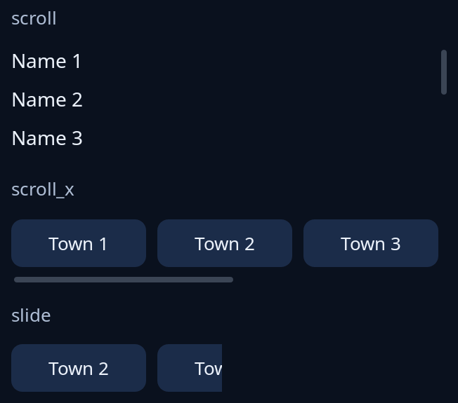

# Scrolling

`scroll(key, inner)` is an area that scrolls what it holds when that is taller, by wheel, touchpad, its bar or the keyboard. `scroll_x` does the same sideways, by Shift and the wheel, a sideways touchpad move or its bar along the foot; give it things of a set width. `slide(inner, width, by)` is a sideways window `width` points wide onto `inner`, showing it from `by` points along; the program moves it. Name a scroll area for what it shows (`key`), as its place is kept by that name, and never give two areas in one window the same name. Give each a height.



**Keys:** on `scroll`, Page Up, Page Down, Home and End. On `scroll_x`, Left and Right, and Shift with Page Up, Page Down, Home and End. A `slide` takes none; the program moves it.

**The screen reader hears:** a scroll area as a scroll view with its place, able to scroll up and down (or left and right) when more is held than shows. What is scrolled out of sight is still read, and so is what has slid out of a `slide`.

For lists that scroll, see [lists](../guides/lists.md).

<!-- picture width 360 -->
```rust
use trindle_toolkit::widget::{column, label, note, row, scroll, scroll_x, slide, word_button, Length, Node};

fn view() -> Node<()> {
    let strip = || row((1..=6).map(|n| word_button(format!("Town {n}")).on_press(()).width(Length::Fixed(96.0))).collect()).gap(8.0);
    column(vec![
        note("scroll"),
        scroll("names", column((1..=8).map(|n| label(format!("Name {n}"))).collect()).gap(8.0)).height(Length::Fixed(80.0)),
        note("scroll_x"),
        scroll_x("towns", strip()).height(Length::Fixed(48.0)),
        note("slide"),
        slide(strip(), 150.0, 104.0),
    ]).gap(12.0).padding(24.0)
}
# let _ = view();
```
