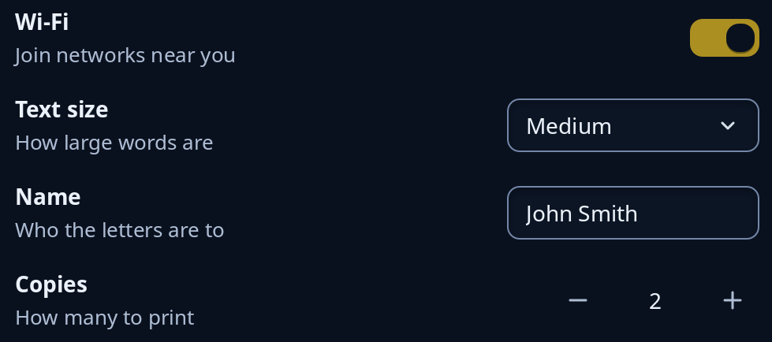

# Settings rows

The usual rows of a settings page. Each is a `settings::setting`: the setting's name over a line of help at the left, and its control at the end of the row. `rows::toggle_row` holds a switch, `combo_row` a dropdown, `entry_row` a text box and `spin_row` a number box with Less and More buttons, each named by the row's own name. Leave the help empty to drop its line.



**Keys:** Those of the control: a [switch](switch-and-tick.md) flips with Space or Enter, a [dropdown](choices-and-dropdowns.md) opens with Space, Enter, Up or Down, a [text box](entry.md) takes typing, and a [spin box](spin-boxes.md) steps with the arrows.

**The screen reader hears:** the control called by the row's name, in its own role (a switch, a combo box, a text box or a slider).

To put the rows on a whole page, see `settings::setting_page`.

<!-- picture width 520 -->
```rust
use trindle_toolkit::rows::{combo_row, entry_row, spin_row, toggle_row};
use trindle_toolkit::widget::{column, Node};

#[derive(Clone)]
enum Msg {
    Wifi(bool),
    Size(usize),
    Name(String),
    Copies(f32),
}

fn view() -> Node<Msg> {
    let sizes = vec!["Small".to_string(), "Medium".to_string(), "Large".to_string()];
    column(vec![
        toggle_row("Wi-Fi", "Join networks near you", true, Msg::Wifi),
        combo_row("Text size", "How large words are", sizes, Some(1), Msg::Size),
        entry_row("Name", "Who the letters are to", "John Smith", Msg::Name),
        spin_row("Copies", "How many to print", 2.0, (1.0, 9.0, 1.0), Msg::Copies),
    ]).gap(16.0).padding(24.0)
}
# let _ = view();
```
