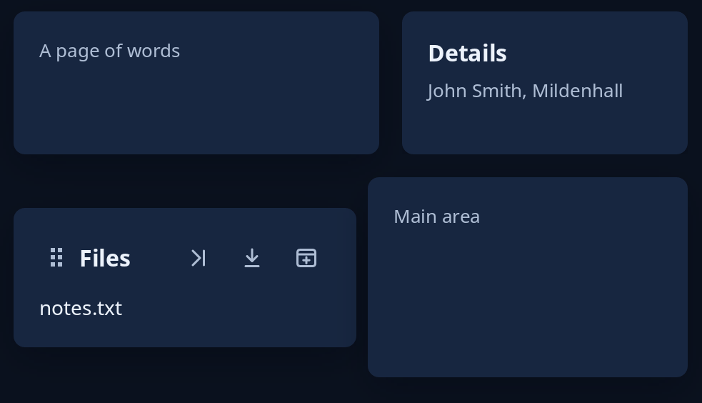

# Side panel and dock

`panel::side_panel(content, panel, width, shown, side)` puts a panel beside the content on `Side::Start` or `Side::End`, `width` points wide when fully in. `shown` runs from 0 (gone, and not in the window at all) to 1; the content gives up room as the panel comes, and a gap keeps them apart. Drive `shown` with `motion::slide`. `dock::Dock` holds panels placed round a main area, as in an editor: on the left, the right or the foot, or floating over the main area. Each panel's head has a handle to drag it by, its title and a button to each other edge; `Dock::update` follows what `view` sends. Give both a height.



**Keys:** the buttons on a dock panel's head are reached by Tab and pressed with Space or Enter. Dragging the handle needs a pointer.

**The screen reader hears:** a side panel at 0 is not there at all, so it cannot be reached; otherwise its contents as usual. A dock panel's handle is called "Drag to another edge", and each button is named with the panel's title, such as "Files: Dock on the right".

<!-- picture width 520 -->
```rust
use trindle_toolkit::dock::{Change, Dock, Edge};
use trindle_toolkit::panel::{side_panel, Side};
use trindle_toolkit::widget::{card, column, heading, label, note, Length, Node};

#[derive(Clone)]
enum Msg {
    Dock(Change),
}

fn view() -> Node<Msg> {
    let mut dock = Dock::default();
    dock.add("files", "Files", Edge::Left);
    column(vec![
        side_panel(
            card(note("A page of words")),
            card(column(vec![heading("Details"), note("John Smith, Mildenhall")]).gap(6.0)),
            200.0,
            1.0,
            Side::End,
        ).height(Length::Fixed(100.0)),
        dock.view(card(note("Main area")), |_| label("notes.txt"), Msg::Dock).height(Length::Fixed(140.0)),
    ]).gap(16.0).padding(24.0)
}
# let _ = view();
```
