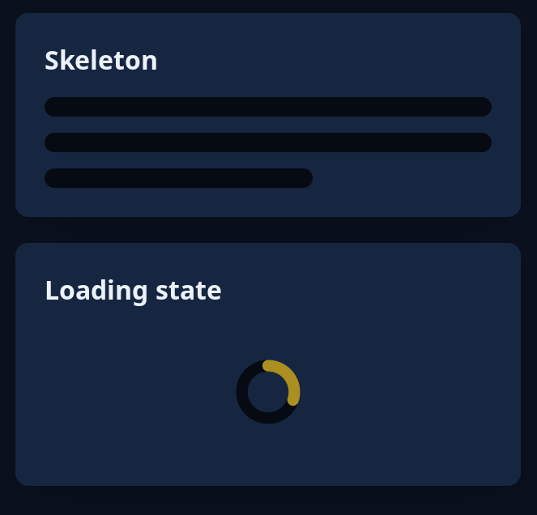

# Skeleton and loading state

Two ways to hold a card's room while its data is still coming, so nothing jumps when it arrives. `tiles::skeleton(lines)` draws grey bars where that many lines of words will come, the last one shorter. It is still, not pulsing, so it needs no reduce-motion setting. `tiles::loading_state(height)` keeps `height` points and puts the standard ring, turning, in the middle (a picture shows one frame of it).



**The screen reader hears:** the skeleton as "Loading", marked busy. The loading state as a progress indicator called "Progress", also busy.

<!-- picture width 360 -->
```rust
use trindle_toolkit::tiles::{loading_state, skeleton};
use trindle_toolkit::widget::{card, column, heading, Node};

fn view() -> Node<()> {
    column(vec![
        card(column(vec![heading("Skeleton"), skeleton(3)]).gap(12.0)),
        card(column(vec![heading("Loading state"), loading_state(80.0)]).gap(12.0)),
    ]).gap(16.0).padding(24.0)
}
# let _ = view();
```
