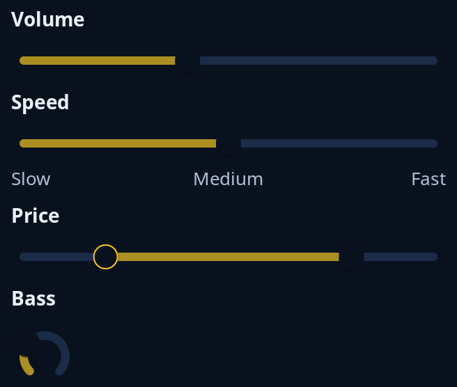

# Sliders

A number in a range, moved by dragging. `slider` is the plain one, `dial::scale` puts words under chosen values such as Slow and Fast, `dial::dial` is a round dial that is also turned with the wheel, and `range::Range` has two handles for the low and the high end of a span. Your state keeps the values.



**Keys:** Tab reaches it. Left and Down take one step off, Right and Up add one, Page Down and Page Up move ten steps, Home and End go to the ends. On a range the keys move the handle the keyboard is on, and Tab goes from the low handle to the high one.

**The screen reader hears:** a slider called by the tip with its value, least and most, which it can be asked to raise or lower. A range is told as two sliders, "low end" and "high end" after the tip.

Sliders beside switches and choices are in [choices](../guides/choices.md); a slider with a mute button is `dial::volume`.

<!-- picture width 360 -->
```rust
use trindle_toolkit::dial::{dial, scale};
use trindle_toolkit::range::{Range, RangeMsg};
use trindle_toolkit::widget::{column, form_label, slider, Length, Node};

#[derive(Clone)]
enum Msg {
    Volume(f32),
    Speed(f32),
    Price(RangeMsg),
    Bass(f32),
}

fn view() -> Node<Msg> {
    column(vec![
        form_label("Volume"),
        slider(40.0, 0.0, 100.0, 1.0, "Volume", Msg::Volume),
        form_label("Speed"),
        scale(5.0, 0.0, 10.0, 1.0, &[(0.0, "Slow"), (5.0, "Medium"), (10.0, "Fast")], "Speed", Msg::Speed).width(Length::Fill),
        form_label("Price"),
        Range::new(2.0, 8.0, 0.0, 10.0, 1.0).node("Price", Msg::Price),
        form_label("Bass"),
        dial(3.0, 0.0, 10.0, 1.0, "Bass", Msg::Bass),
    ]).gap(8.0).padding(24.0)
}
# let _ = view();
```
