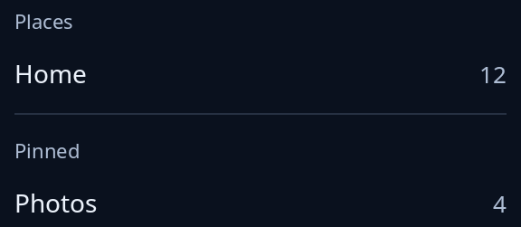

# Space and rule

`space` is empty room that takes what is left, pushing what follows it to the end of a row or column. `section_rule` is the light line between two sections of a side bar, right across it; its colour and thickness come from the style sheet (`--trindle-section-line`, `--trindle-section-line-width`).



**The screen reader hears:** nothing from the rule; it is painted only for the look and left out.

For the other containers, see [layout](../guides/layout.md).

<!-- picture width 320 -->
```rust
use trindle_toolkit::widget::{column, label, note, row, section_rule, side_heading, space, Node};

fn view() -> Node<()> {
    column(vec![
        side_heading("Places"),
        row(vec![label("Home"), space(), note("12")]),
        section_rule(),
        side_heading("Pinned"),
        row(vec![label("Photos"), space(), note("4")]),
    ]).gap(12.0).padding(24.0)
}
# let _ = view();
```
