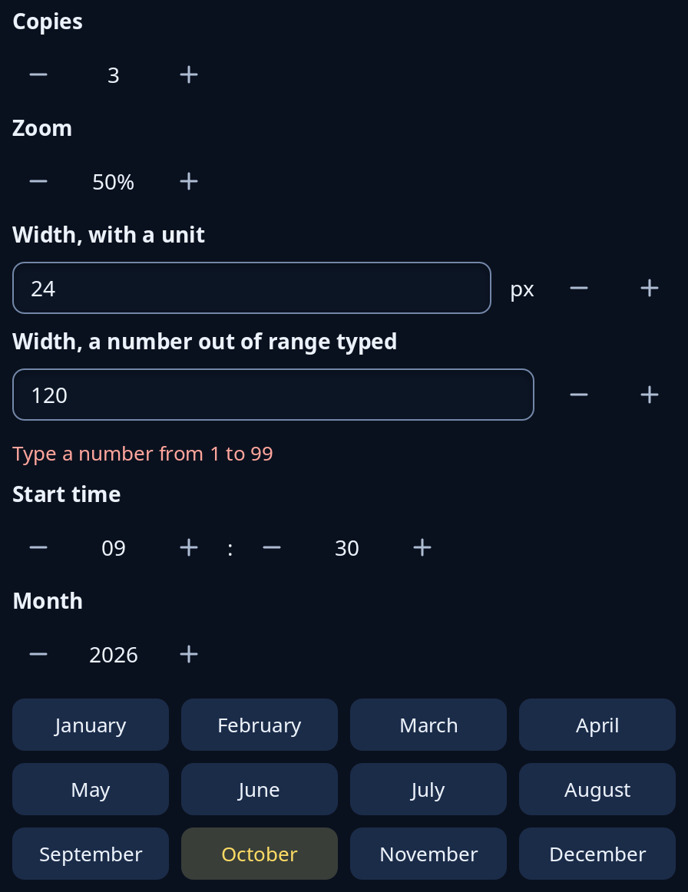

# Spin boxes

A number stepped by buttons. `spin::spin` is a number between Less and More buttons, `spin_with` writes the number your own way, `spin::Spin` is a box you can type a number into, with limits, a step, places and a unit, and shows red words under it when what is typed is out of range. `spin::time_spin` is hours and minutes, and `spin::month_year` is a year over the twelve months.



**Keys:** In `spin` and `spin_with` the number takes the keyboard: Left and Down take a step off, Right and Up add one, Page Down and Page Up move ten steps, Home and End go to the ends, and the wheel steps. In a `Spin` box type the number; Up and Down step, Page Up and Page Down move ten steps, and Enter or leaving the box takes what was typed. The Less and More buttons are reached by Tab and pressed with Space or Enter.

**The screen reader hears:** a slider called by the tip, with its value, least and most, between buttons called "Less" and "More" and the tip. A `Spin` box is a spin button with the same.

<!-- picture width 480 -->
```rust
use trindle_toolkit::spin::{month_year, spin, spin_with, time_spin, Spin, SpinMsg};
use trindle_toolkit::when::Time;
use trindle_toolkit::widget::{column, form_label, Node};

#[derive(Clone)]
enum Msg {
    Copies(f32),
    Zoom(f32),
    Width(SpinMsg),
    Time(Time),
    Month(i32, u32),
}

fn view() -> Node<Msg> {
    let refused = Spin { typed: Some("120".into()), ..Spin::new(120.0, 1.0, 99.0, 1.0) };
    column(vec![
        form_label("Copies"),
        spin(3.0, 1.0, 10.0, 1.0, "Copies", Msg::Copies),
        form_label("Zoom"),
        spin_with(0.5, 0.0, 1.0, 0.1, "Zoom", |v| format!("{:.0}%", v * 100.0), Msg::Zoom),
        form_label("Width, with a unit"),
        Spin::new(24.0, 1.0, 99.0, 1.0).unit("px").node("Width", Msg::Width),
        form_label("Width, a number out of range typed"),
        refused.node("Width", Msg::Width),
        form_label("Start time"),
        time_spin(Time::new(9, 30).unwrap(), Msg::Time),
        form_label("Month"),
        month_year(2026, 10, Msg::Month),
    ]).gap(8.0).padding(24.0)
}
# let _ = view();
```
