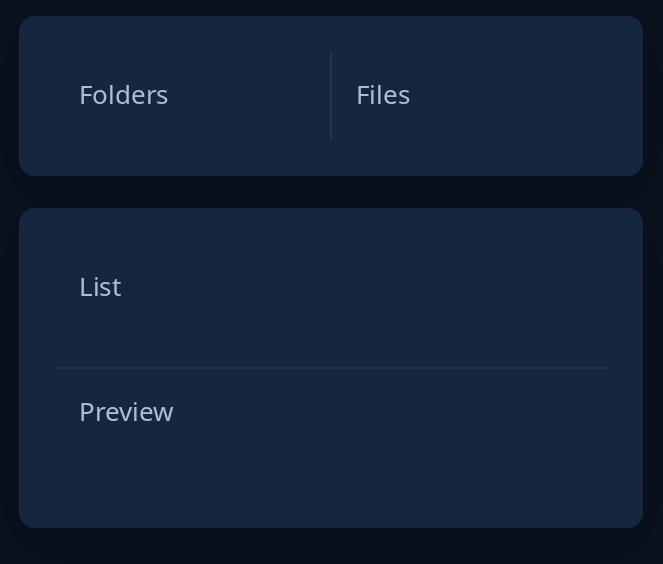

# Split

`split(key, first, second)` puts two areas side by side with a divider you drag; `split_down` puts one over the other. The first side starts at half the room (change it with `.start(Start::Part(f))` or `.start(Start::Points(p))`) and each side keeps at least 120 points unless `.least(first, second)` says otherwise. The toolkit keeps where the divider was left under `key`, as `scroll` does; `Ui::split_places` gives the places out so a program can save them. A double click puts the divider back. Give the split a height.



**Keys:** Tab reaches the divider, after both sides. Left and Right move it by 16 points (Up and Down for `split_down`); Home and End take it to either side's least.

**The screen reader hears:** a splitter named "Divider" whose value is the first side's share in hundredths, with its least and most.

<!-- picture width 360 -->
```rust
use trindle_toolkit::widget::{card, column, note, split, split_down, Length, Node};

fn pane(words: &str) -> Node<()> {
    column(vec![note(words)]).padding(12.0)
}

fn view() -> Node<()> {
    column(vec![
        card(split("folders", pane("Folders"), pane("Files"))).height(Length::Fixed(80.0)),
        card(split_down("notes", pane("List"), pane("Preview")).least(40.0, 40.0)).height(Length::Fixed(160.0)),
    ]).gap(16.0).padding(24.0)
}
# let _ = view();
```
