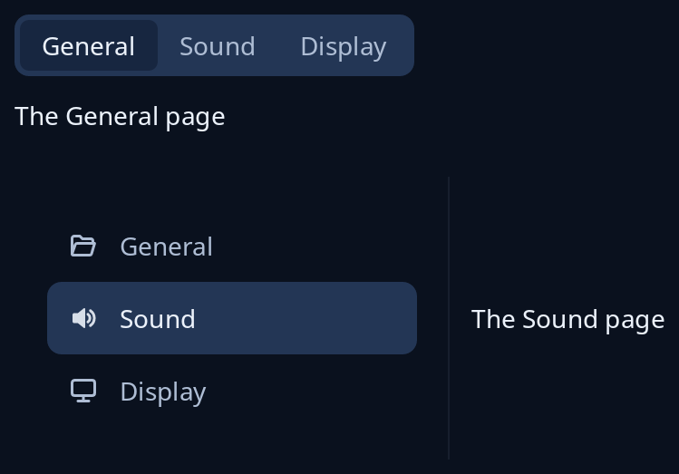

# Stack

`nav::stack` puts the names of a program's pages in a strip over the page shown, with the current name filled. `nav::stack_beside` gives the same as places down a side bar beside the page, each with an icon. Pressing a name sends the place picked, and the program shows that page.



**Keys:** Tab reaches the strip, then the arrow keys move along it and Home and End go to the first and last. In the side bar the arrows, Page Up, Page Down, Home and End move the chosen row. A program can add Ctrl+Page Down, Ctrl+Page Up, Ctrl+Tab and Ctrl+Shift+Tab with `nav::page_key` in its `intercept`.

**The screen reader hears:** the strip as a group of radio buttons named "Pages", the chosen one on; the side bar as a list named "Pages" with the chosen row selected.

<!-- picture width 480 -->
```rust
use trindle_toolkit::nav;
use trindle_toolkit::widget::{column, item, label, Node};

#[derive(Clone)]
enum Msg {
    Page(usize),
}

fn view() -> Node<Msg> {
    let names = vec!["General".into(), "Sound".into(), "Display".into()];
    let places = vec![
        item("General").icon("document-open-symbolic"),
        item("Sound").icon("audio-volume-high-symbolic"),
        item("Display").icon("video-display-symbolic"),
    ];
    column(vec![
        nav::stack(names, 0, Msg::Page, label("The General page")),
        nav::stack_beside(places, 1, Msg::Page, label("The Sound page")),
    ]).gap(24.0).padding(24.0)
}
# let _ = view();
```
