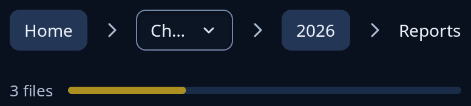

# Status bar and path bar

`bars::status_bar(items)` is the line at a window's foot that says how things stand: its items sit side by side (words, a progress bar, a chip) on the foot surface from the style sheet. `bars::path_bar(parts, keep, go)` shows a place's path, such as a folder's, as pressable parts from the top; the last part is where you are and is plain words. A path of more than `keep` + 1 parts shows the first, a list of those in the middle to choose from, then the last `keep`. `go` is given the part's place in `parts`.



**Keys:** each part of the path is a button, reached with Tab and pressed with Enter or Space; the list of middle places is a dropdown.

**The screen reader hears:** the status bar as a status called "Status", with what it holds. The path bar as navigation called "Path", each part a button and the last one plain words.

<!-- picture width 420 -->
```rust
use trindle_toolkit::bars::{path_bar, progress_bar, status_bar};
use trindle_toolkit::widget::{column, note, Node};

fn view() -> Node<()> {
    let parts: Vec<String> = ["Home", "john", "Documents", "Work", "2026", "Reports"].iter().map(|s| s.to_string()).collect();
    column(vec![
        path_bar(&parts, 2, |_| ()),
        status_bar(vec![note("3 files"), progress_bar(Some(0.3), "Copying")]),
    ]).gap(24.0).padding(24.0)
}
# let _ = view();
```
