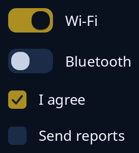

# Switch and tick box

`switch` is an on and off control for something that takes effect at once. `tick` is a tick box for a choice that waits for a button. The tip names each one, and a press says the opposite of what is shown, so the program keeps the truth.



**Keys:** Tab reaches it, then Space or Enter flips it.

**The screen reader hears:** a switch or a check box named by the tip, with its state on or off.

For a box to draw yourself, see `tiles::tick_box`; for several choices at once, see [choices](../guides/choices.md).

<!-- picture width 280 -->
```rust
use trindle_toolkit::widget::{column, label, row, switch, tick, Node};

#[derive(Clone)]
enum Msg {
    Wifi(bool),
    Agree(bool),
}

fn view() -> Node<Msg> {
    column(vec![
        row(vec![switch(true, "Wi-Fi", Msg::Wifi), label("Wi-Fi")]).gap(12.0),
        row(vec![switch(false, "Bluetooth", Msg::Wifi), label("Bluetooth")]).gap(12.0),
        row(vec![tick(true, "I agree", Msg::Agree), label("I agree")]).gap(12.0),
        row(vec![tick(false, "Send reports", Msg::Agree), label("Send reports")]).gap(12.0),
    ]).gap(16.0).padding(24.0)
}
# let _ = view();
```
