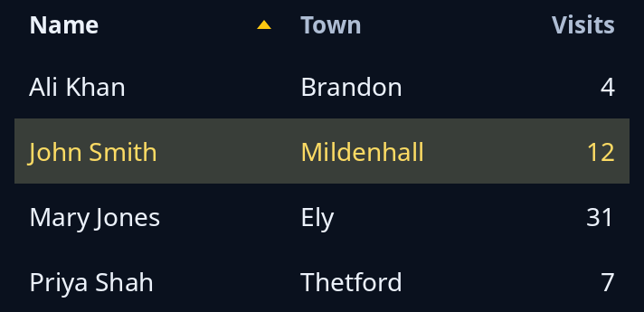

# Table

`table::Table` is a table you paint: headings that sort, resize and move, a chosen row (or several), group headings, cells typed in, rows that open under a parent, and only the rows in sight painted, so thousands cost no more than a few. The program keeps the `Table`, paints it with `paint_table` inside a `drawing`, and passes it pointer and keys: `Gesture::pointer_mods` for the pointer and `Table::key` for the keys. The Table holds no data; `paint_table` asks for each cell's words by row and column.



**Keys:** `Table::key` handles the rows. The arrows, Page Up, Page Down, Home and End move the chosen row. With `multiple` on, Shift extends the choice, Ctrl+A chooses every row and Space toggles the chosen one. In a column view Right opens a closed branch or goes to the first row under an open one, Left closes it or goes to its parent, and Enter or Space opens or closes a branch. Enter on any other row says it was opened.

**The screen reader hears:** a table, or a tree grid for a column view, with its headings, the sort, "row n of m", each cell's words and the chosen rows as selected, when the drawing is given `.table_rows(table.said(..))`.

`examples/gallery.rs` wires the pointer, the keys and a column view.

<!-- picture width 400 -->
```rust
use trindle_toolkit::table::{paint_table, Column, Table};
use trindle_toolkit::widget::{column, drawing, Node};

const PEOPLE: [[&str; 3]; 4] = [
    ["Ali Khan", "Brandon", "4"],
    ["John Smith", "Mildenhall", "12"],
    ["Mary Jones", "Ely", "31"],
    ["Priya Shah", "Thetford", "7"],
];

fn words(row: usize, col: usize) -> String {
    PEOPLE[row][col].to_string()
}

fn view() -> Node<()> {
    let mut table = Table::new(vec![
        Column::new("Name", 150.0).sortable(),
        Column::new("Town", 110.0).sortable(),
        Column::new("Visits", 80.0).sortable().end(),
    ]);
    table.set_rows(PEOPLE.len());
    table.sort = Some((0, true));
    table.chosen = Some(1);
    let tall = table.head_height + table.row_height * PEOPLE.len() as f32;
    let said = table.said(tall, words);
    column(vec![
        drawing((table.width(), tall), "People", move |canvas, pen| paint_table(canvas, pen, &table, None, words)).table_rows(said),
    ]).padding(24.0)
}
# let _ = view();
```
