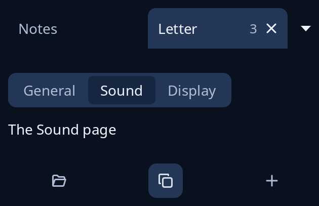

# Tabs and toolbox

`tabs::Tabs` is a bar of tabs the program paints itself, with close boxes, reordering and a button for the tabs that do not fit. `toolbox::tab_pages` is a plainer row of tab names over the page shown, and may nest. `toolbox::toolbox` is a grid of round tool buttons with the one in use shown on.



**Keys:** the painted bar takes the pointer through `tabs::Gesture`: a press chooses, the close box or a middle click closes, a drag reorders. Its keys are the program's: `Tabs::step(-1, width)` and `step(1, width)` move along it, and `shift` moves the chosen tab. In `tab_pages` the arrow keys, Home and End move along the row. A tool is a button: Tab reaches it, then Space or Enter.

**The screen reader hears:** the painted bar as a tab list ("tab 2 of 5", the chosen one selected, a Close button in each tab that can close) once given `Node::tab_list(tabs.said(width))`; `tab_pages` as a group of radio buttons named by its tip; each tool as a toggle that is pressed or not.

<!-- picture width 360 -->
```rust
use trindle_toolkit::tabs::{paint_tabs, Tab, Tabs};
use trindle_toolkit::toolbox::{tab_pages, toolbox, Tool};
use trindle_toolkit::widget::{column, drawing, label, Node};

#[derive(Clone)]
enum Msg {
    Page(usize),
    Tool(usize),
}

fn view() -> Node<Msg> {
    let mut tabs = Tabs::new(vec![Tab::new("Notes").fixed(), Tab::new("Letter").count(3), Tab::new("Sums")]);
    tabs.chosen = 1;
    let tools = [
        Tool { icon: "document-open-symbolic", name: "Open" },
        Tool { icon: "edit-copy-symbolic", name: "Copy" },
        Tool { icon: "list-add-symbolic", name: "Add" },
    ];
    column(vec![
        drawing((312.0, 40.0), "Tabs", move |canvas, pen| paint_tabs(canvas, pen, &tabs, None, None)),
        tab_pages(vec!["General".into(), "Sound".into(), "Display".into()], 1, "Settings", Msg::Page, label("The Sound page")),
        toolbox(&tools, 1, Msg::Tool),
    ]).gap(24.0).padding(24.0)
}
# let _ = view();
```
