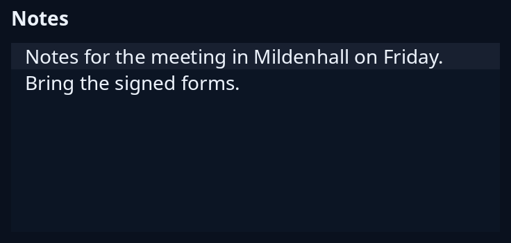

# Text area

`editing::area::TextArea` is a many-line text box with undo and redo, wrapping, a scroll bar, the clipboard and a right-click menu. `editing::editor::Pane` is the editing engine's drawn area that sits under it, for a program that needs the caret's place or search marks, reached with `TextArea::pane`.



**Keys:** The arrows, Page Up, Page Down, Home and End move the caret, Backspace, Delete, Enter and Tab edit, Ctrl+A selects all, Ctrl+C, Ctrl+X and Ctrl+V copy, cut and paste, Ctrl+Z undoes, and Ctrl+Y or Ctrl+Shift+Z redoes. The right-click menu offers Cut, Copy, Paste and Select all.

**The screen reader hears:** a multi-line text box called by the name, with the lines from the top of the view, the caret and the selection. With `spelling` on, it is also told while a mistake is in sight.

The area keeps the words itself, so hold one `TextArea` in your state (a clone shares them). Put `node` in the window, hand each `Event` back to `handle` and read the words with `text`.

<!-- picture width 400 -->
```rust
use trindle_toolkit::editing::area::{Event, TextArea};
use trindle_toolkit::editing::editor::Look;
use trindle_toolkit::widget::{column, form_label, Node};

#[derive(Clone)]
enum Msg {
    Area(Event),
}

fn view() -> Node<Msg> {
    let area = TextArea::new(
        "Notes for the meeting in Mildenhall on Friday.\nBring the signed forms.",
        Look { font: None, size: 14.0, wrap: true, numbers: false },
    );
    column(vec![
        form_label("Notes"),
        area.node("Notes", 120.0, Msg::Area),
    ]).gap(8.0).padding(24.0)
}
# let _ = view();
```
