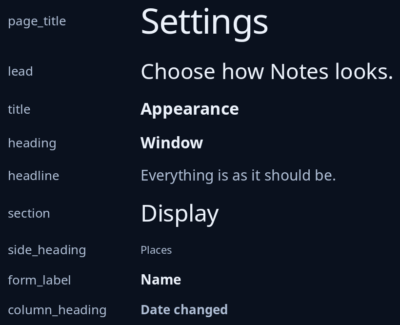

# Text roles

One function for each role words can have, so the style sheet decides the look and a page reads the same in every program. `page_title` is the page's own name; `lead` the sentence at its top; `title` a heading in the window (not the window's own title); `section` the name of a part of a page; `heading` the name over a card; `headline` the sentence in a headline card. `side_heading` names a side bar group, `form_label` names a setting or a box, and `column_heading` heads a table's column. Write them all in sentence case.



**The screen reader hears:** `page_title` as a heading of level 1, `title` as level 2, `heading` as level 3 and `section` as level 4. The rest are heard as plain words.

For plain, quiet and big words, see [label, note and figure](label-note-figure.md).

<!-- picture width 520 -->
```rust
use trindle_toolkit::widget::{
    column, column_heading, form_label, heading, headline, lead, note, page_title, row, section, side_heading, title, Length, Node,
};

fn view() -> Node<()> {
    let named = |role: &str, words: Node<()>| row(vec![note(role).width(Length::Fixed(120.0)), words]).gap(16.0);
    column(vec![
        named("page_title", page_title("Settings")),
        named("lead", lead("Choose how Notes looks.")),
        named("title", title("Appearance")),
        named("heading", heading("Window")),
        named("headline", headline("Everything is as it should be.")),
        named("section", section("Display")),
        named("side_heading", side_heading("Places")),
        named("form_label", form_label("Name")),
        named("column_heading", column_heading("Date changed")),
    ]).gap(12.0).padding(24.0)
}
# let _ = view();
```
