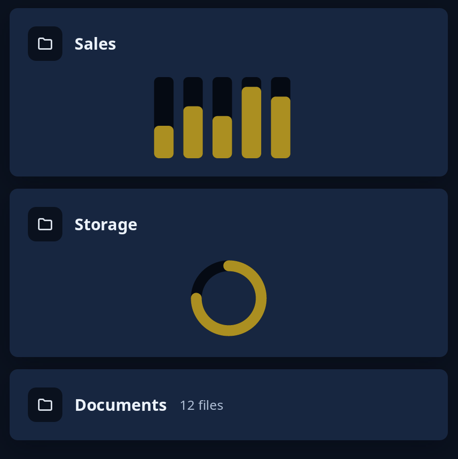

# Tile pictures

`tiles::sketch` is a picture you draw in units of your own, as an SVG has a view box: it is scaled to fit its tile, centred, and never less than a height you give. `tiles::picture` puts one in a tile with its head, taking whatever height the page's puzzle gives it. `tiles::tile_head` is the head alone: an icon in a grey circle, a name, then anything you put beside it, such as a count or an i button.

The drawing takes its colours from the `Sketch`, so it follows light, dark and the person's highlight: `s.highlight()`, `s.track()`, `s.boxed()`, `s.words()` and `s.quiet()`.



**The screen reader hears:** the head's name as a heading, and the sketch as an image named by its tip.

For your own widgets that take the pointer or keys, see [custom widgets](../guides/custom-widgets.md).

<!-- picture width 480 -->
```rust
use trindle_toolkit::tiles::{picture, sketch, tile_head};
use trindle_toolkit::widget::{bento, card, note, Node};

fn view() -> Node<()> {
    let sales = sketch("Sales this week", (100.0, 50.0), 80.0, |s| {
        let (track, mark) = (s.track(), s.highlight());
        for (i, h) in [20.0, 32.0, 26.0, 44.0, 38.0].into_iter().enumerate() {
            let x = 4.0 + i as f32 * 18.0;
            s.rect((x, 0.0, 12.0, 50.0), 3.0, track);
            s.rect((x, 50.0 - h, 12.0, h), 3.0, mark);
        }
    });
    let used = sketch("Three quarters used", (60.0, 60.0), 80.0, |s| {
        let (track, mark) = (s.track(), s.highlight());
        s.ring((30.0, 30.0), 24.0, 8.0, track);
        s.arc((30.0, 30.0), 24.0, 8.0, 0.0, 0.75, mark);
    });
    bento(200.0, 12.0, vec![
        picture("folder-symbolic", "Sales", sales),
        picture("folder-symbolic", "Storage", used),
        card(tile_head("folder-symbolic", "Documents", vec![note("12 files")])),
    ]).padding(24.0)
}
# let _ = view();
```
