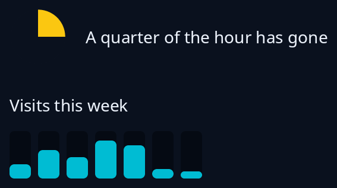

# Time pie and bars

`tiles::time_pie(share, across, colours)` is a solid pie that fills clockwise from the top on a disc, for time passing or time left. `colours` is given the look and returns the disc's colour and then the pie's, so a pie drawn with a look of its own need not take the theme's. `tiles::bars(palette, values)` is a small picture of amounts: a rounded column for each value from 0 to 1, in one of the 19 palette colours, across the width it is given.



**The screen reader hears:** nothing from either, as they are drawn for the eye only. Put the amount in words beside them.

<!-- picture width 360 -->
```rust
use trindle_toolkit::theme::{Palette, Theme};
use trindle_toolkit::tiles::{bars, time_pie};
use trindle_toolkit::widget::{column, label, row, Node};

fn view() -> Node<()> {
    column(vec![
        row(vec![time_pie(0.25, 48.0, |t: &Theme| (t.ring, t.accent)), label("A quarter of the hour has gone")]).gap(16.0),
        column(vec![
            label("Visits this week"),
            bars(Palette::Indigo, vec![0.3, 0.6, 0.45, 0.8, 0.7, 0.2, 0.1]),
        ]).gap(12.0),
    ]).gap(24.0).padding(24.0)
}
# let _ = view();
```
