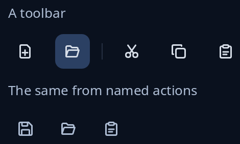

# Toolbar

`bars::Toolbar` is a row of icon tools; those that do not fit go into a menu opened from a More button at the end. Make each tool with `tool(icon, tip)` (the tip is its name for the reader and its row in the menu) and `.rule()` to start a new group after a thin line. The program keeps the `Toolbar`, builds it with `node(wrap)`, and gives each `ToolMsg` it sends to `update`, which returns the tool pressed.

`action::Actions::toolbar(ids, wrap)` makes a plain row of round icon buttons from named actions, named by their words. An action that cannot be done now is greyed out and stays in its place.



**Keys:** on a `Toolbar`, Left, Right, Home and End move the lit tool (More counts as the last), and Enter or Space presses it. The `Actions` buttons are ordinary buttons.

**The screen reader hears:** the `Toolbar` as a toolbar called "Tools", each tool a button named by its tip, and a "More tools" button when some overflow. Each `Actions` button is heard by its label.

<!-- picture width 400 -->
```rust
use trindle_toolkit::action::{Action, Actions};
use trindle_toolkit::bars::{tool, Toolbar};
use trindle_toolkit::widget::{column, note, Node};

fn view() -> Node<()> {
    let mut bar = Toolbar::new(vec![
        tool("document-new-symbolic", "New"),
        tool("document-open-symbolic", "Open"),
        tool("edit-cut-symbolic", "Cut").rule(),
        tool("edit-copy-symbolic", "Copy"),
        tool("edit-paste-symbolic", "Paste"),
    ]);
    bar.lit = Some(1);

    let mut actions = Actions::new();
    actions.add(Action::new("save", "Save").icon("document-save-symbolic")).unwrap();
    actions.add(Action::new("open", "Open").icon("document-open-symbolic")).unwrap();
    actions.add(Action::new("paste", "Paste").icon("edit-paste-symbolic")).unwrap();
    actions.set_enabled(&"paste", false);

    column(vec![
        note("A toolbar"),
        bar.node(|_| ()),
        note("The same from named actions"),
        actions.toolbar(&["save", "open", "paste"], |_| ()),
    ]).gap(12.0).padding(24.0)
}
# let _ = view();
```
