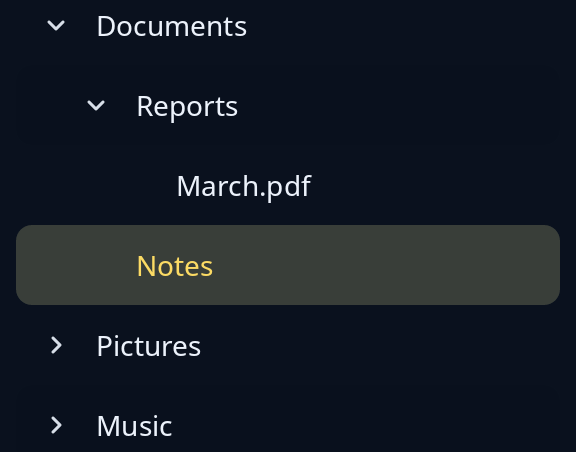

# Tree

`tree` shows folders, or anything else that nests, in a side bar. Each row made with `tree_row(item, depth)` is set in by its depth; `.branch(open)` makes it a branch with a small arrow. The program keeps which branches are open and gives only the rows that show, so a closed branch's children are never built.



**Keys:** Up and Down choose a row. Right opens a closed branch, or goes to the first row inside an open one. Left closes an open branch, or goes to the branch that holds the row. Enter and Space open or close a branch; on a leaf they send the open message.

**The screen reader hears:** a tree, each row a tree item with its level, its place in the set and, for a branch, whether it is expanded. The reader can ask a branch to expand or collapse.

`tree(rows, chosen, choose, toggle, open)` sends `choose` when the chosen row changes, `toggle` when a branch should open or close, and `open` for Enter on a leaf. Items are made as for [list](list.md).

<!-- picture width 320 -->
```rust
use trindle_toolkit::widget::{column, item, tree, tree_row, Length, Node};

#[derive(Clone)]
enum Msg {
    Choose(usize),
    Toggle(usize),
    Open(usize),
}

fn view() -> Node<Msg> {
    let rows = vec![
        tree_row(item("Documents"), 0).branch(true),
        tree_row(item("Reports"), 1).branch(true),
        tree_row(item("March.pdf"), 2),
        tree_row(item("Notes"), 1),
        tree_row(item("Pictures"), 0).branch(false),
        tree_row(item("Music"), 0).branch(false),
    ];
    column(vec![
        tree(rows, Some(3), Msg::Choose, Msg::Toggle, Msg::Open).called("Folders").height(Length::Fixed(250.0)),
    ]).padding(24.0)
}
# let _ = view();
```
