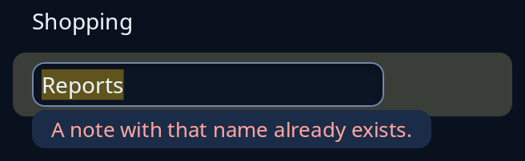

# Typing over a row

`typing_over` lays a text box over one part of a page while a name drawn there is being changed: a row of a list, or the name under an icon. The box takes the room you give it and nothing else, so the row keeps its height and everything round it keeps its place. Why a name cannot be used is said in red words just under the box, over whatever is there, so nothing is pushed down to make room for them. What is under keeps the same name with and without the box, so its scroll place and the pointer's hold on it are not lost when the box comes or goes.

You give it the page, and `Some(InPlace { place, entry, problem })` while the name is open for typing, `None` otherwise. `place` is where the box goes, in points from the top left of the page.



**Keys:** the box is an ordinary text box. Give it `on_submit`, `on_escape` and `on_tab` for Enter, Escape and Tab; `selects` picks which part of the name is selected as it opens, and `grab` takes the keyboard as it opens.

**The screen reader hears:** the box by its tip, which should say what is being renamed.

<!-- picture width 360 -->
```rust
use trindle_toolkit::widget::{column, entry, item, list, typing_over, InPlace, Length, Node, Rect};

#[derive(Clone)]
enum Msg {
    Pick(usize),
    Name(String),
    Keep,
    Stop,
}

fn view() -> Node<Msg> {
    let notes = list(vec![item("Shopping"), item("Reports")], Some(1), Msg::Pick)
        .called("Notes")
        .height(Length::Fixed(160.0));
    let editing = InPlace {
        place: Rect { x: 12.0, y: 46.0, w: 220.0, h: 28.0 },
        entry: entry("Reports", "New name for Reports", Msg::Name).selects(0..7).on_submit(Msg::Keep).on_escape(Msg::Stop),
        problem: Some("A note with that name already exists.".into()),
    };
    column(vec![typing_over(notes, Some(editing))]).padding(24.0)
}
# let _ = view();
```
