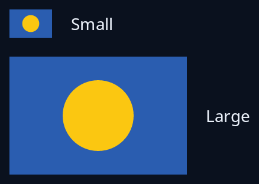

# Vector picture

`vector` shows an SVG drawn from its shapes at whatever size it is given, so it stays sharp at any size and on any screen. Read the file once with `picture::svg_tree`, which follows nothing the picture names, keep the tree, and pass it in a shared `Rc`. The picture keeps its shape and sits in the middle of the room it has.



**The screen reader hears:** an image named by the text you give.

<!-- picture width 320 -->
```rust
use std::rc::Rc;
use trindle_toolkit::picture::svg_tree;
use trindle_toolkit::vector::vector;
use trindle_toolkit::widget::{column, label, row, Node};

const FLAG: &[u8] = br##"<svg xmlns="http://www.w3.org/2000/svg" width="60" height="40"><rect width="60" height="40" fill="#2a5db0"/><circle cx="30" cy="20" r="12" fill="#fbc711"/></svg>"##;

fn view() -> Node<()> {
    let tree = Rc::new(svg_tree(FLAG).expect("a valid picture"));
    column(vec![
        row(vec![vector(tree.clone(), (36.0, 24.0), "A blue flag with a yellow disc"), label("Small")]).gap(16.0),
        row(vec![vector(tree, (150.0, 100.0), "A blue flag with a yellow disc"), label("Large")]).gap(16.0),
    ]).gap(16.0).padding(24.0)
}
# let _ = view();
```
