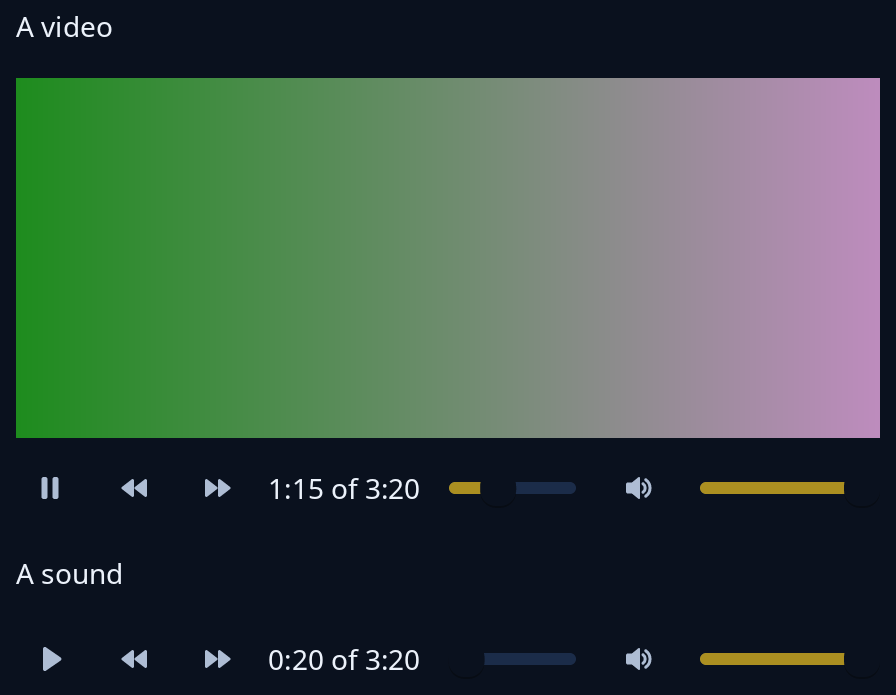

# Video and player

`moving` shows video frames that you feed it: the program decodes, and puts each frame in a shared `Frames` from any thread, and the window shows the latest, stretched to fill, black until the first arrives. `Player` keeps the state of a video or sound player; its `view` draws the picture, if there is one, over a row of play or pause, back and forward 5 seconds, the time, a bar to seek along, mute and volume. The program decodes through the `Decoder` it fills in.



**Keys:** the controls are buttons and sliders reached by Tab. `Player::key` turns Space or K into play and pause, Left or J into back, Right or L into forward and M into mute, for the program to send on from the keys of whatever holds the player.

**The screen reader hears:** the picture named by the text you give; buttons named Play or Pause, "Back 5 seconds", "Forward 5 seconds" and Mute or "Sound on"; sliders named Position and Volume.

<!-- picture width 480 -->
```rust
use std::sync::{Arc, Mutex};
use std::time::Duration;
use trindle_toolkit::player::{Control, Player, State};
use trindle_toolkit::widget::{column, label, Node};

#[derive(Clone)]
enum Msg {
    Player(Control),
}

fn view() -> Node<Msg> {
    let mut frame = tiny_skia::Pixmap::new(160, 90).expect("a frame");
    for (i, p) in frame.data_mut().chunks_exact_mut(4).enumerate() {
        let v = 30 + (i % 160) as u8;
        p.copy_from_slice(&[v, 140, v, 255]);
    }
    let mut video = Player::new(Some(Duration::from_secs(200)), Some(Arc::new(Mutex::new(Some(frame)))));
    video.state = State::Playing;
    video.reached(Duration::from_secs(75));
    let mut sound = Player::new(Some(Duration::from_secs(200)), None);
    sound.reached(Duration::from_secs(20));
    column(vec![
        label("A video"),
        video.view((320.0, 180.0), "Holiday in Mildenhall", Msg::Player),
        label("A sound"),
        sound.view((0.0, 0.0), "Morning radio", Msg::Player),
    ]).gap(16.0).padding(24.0)
}
# let _ = view();
```
