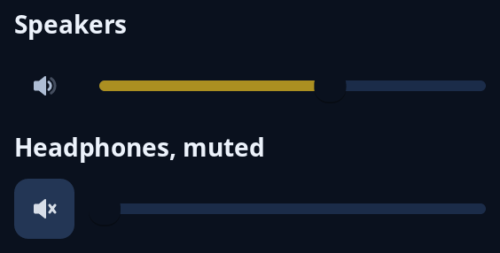

# Volume

`dial::volume` is a mute button with a slider beside it, from 0 to 1 in steps of 0.05. The button's icon shows how loud it is: muted, low, medium or high. Both stay in the row and nothing pops up. Your state keeps the level and whether it is muted; a muted volume shows its slider at nothing.



**Keys:** Tab reaches the button, where Space or Enter mutes or unmutes, and then the slider, where Left and Down take a step off, Right and Up add one, Page Down and Page Up move ten steps, and Home and End go to the ends.

**The screen reader hears:** a button called "Mute", or "Unmute" and told as on while muted, then a slider called "Volume".

For other sliders see [sliders](sliders.md).

<!-- picture width 320 -->
```rust
use trindle_toolkit::dial::volume;
use trindle_toolkit::widget::{column, form_label, Node};

#[derive(Clone)]
enum Msg {
    Mute,
    Level(f32),
}

fn view() -> Node<Msg> {
    column(vec![
        form_label("Speakers"),
        volume(0.6, false, Msg::Mute, Msg::Level),
        form_label("Headphones, muted"),
        volume(0.6, true, Msg::Mute, Msg::Level),
    ]).gap(8.0).padding(24.0)
}
# let _ = view();
```
