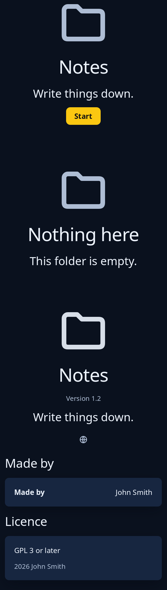

# Welcome, status and about pages

`pages::welcome_page` is the first page a program shows: its icon, its name, a sentence and one main action. `pages::status_page` is a page with one thing to say in the middle of its room, such as an empty folder or a lost connection: a large quiet icon, a title, a sentence and at most one action. `pages::about_page` gives a program's icon, name, version, sentence, website, credits and licence, scrolling under a key.



**Keys:** Tab reaches the action, then Space or Enter presses it. The about page scrolls by the wheel and its bar, and its website is a link button.

**The screen reader hears:** the title and the sentence as words, the action as a button, and on the about page "Version 1.2", the website link, the credits and the licence as words.

<!-- picture width 400 -->
```rust
use trindle_toolkit::pages::{about_page, status_page, welcome_page, About};
use trindle_toolkit::widget::{column, Length, Node};

#[derive(Clone)]
enum Msg {
    Start,
}

fn view() -> Node<Msg> {
    let about = About {
        name: "Notes".into(),
        icon: "folder-symbolic".into(),
        version: "1.2".into(),
        summary: "Write things down.".into(),
        website: Some("https://example.com".into()),
        credits: vec![("Made by".into(), vec!["John Smith".into()])],
        licence: "GPL 3 or later".into(),
        copyright: "2026 John Smith".into(),
    };
    column(vec![
        welcome_page("folder-symbolic", "Notes", "Write things down.", "Start", Msg::Start).height(Length::Fixed(300.0)),
        status_page("folder-symbolic", "Nothing here", "This folder is empty.", None).height(Length::Fixed(260.0)),
        about_page("about", &about).height(Length::Fixed(600.0)),
    ]).gap(24.0).padding(24.0)
}
# let _ = view();
```
