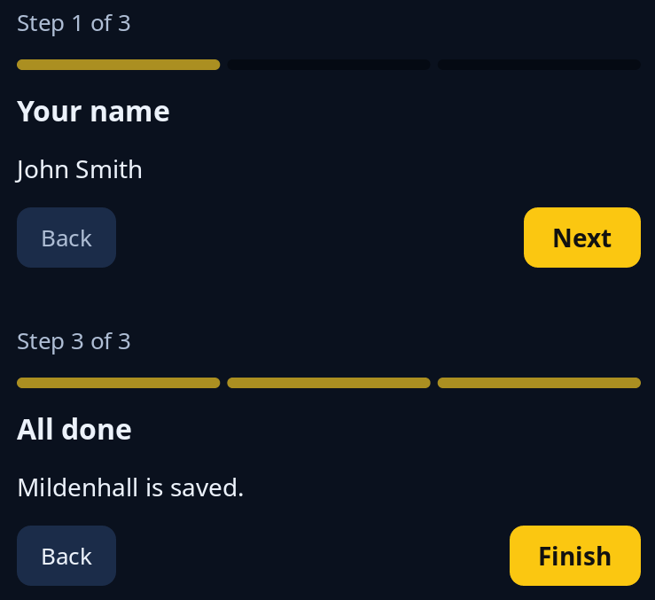

# Wizard

`steps::wizard` is one page of a wizard: a line saying "Step 2 of 3", a strip with the steps done filled, the step's name, the page itself, and Back and Next at the foot. The program keeps which step it is on and turns the two messages into a new step. Back is greyed out on the first page, and the last page's forward button says Finish.



**Keys:** Tab reaches Back and Next (Back is skipped on the first page), then Space or Enter presses the button.

**The screen reader hears:** "Step 1 of 3", the step's name, the page, and buttons named Back, Next or Finish.

<!-- picture width 400 -->
```rust
use trindle_toolkit::steps::wizard;
use trindle_toolkit::widget::{column, label, Node};

#[derive(Clone)]
enum Msg {
    Back,
    Forward,
}

fn view() -> Node<Msg> {
    let titles: Vec<String> = vec!["Your name".into(), "Your town".into(), "All done".into()];
    column(vec![
        wizard(0, &titles, label("John Smith"), Msg::Back, Msg::Forward),
        wizard(2, &titles, label("Mildenhall is saved."), Msg::Back, Msg::Forward),
    ]).gap(32.0).padding(24.0)
}
# let _ = view();
```
